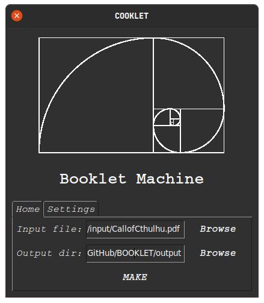
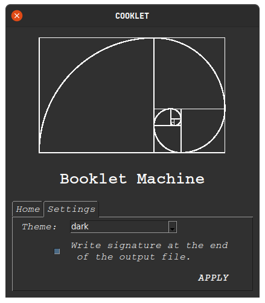

# BOOKLET

A Python program, using Tkinter, to convert dinA4 paper PDF to an easy-to-print and easy-to-sew book

Home             |  Settings
:-------------------------:|:-------------------------:
 | 

## Getting Started

There are two ways to set up and run the project:

**Using uv:**
1. Create the environment: `uv venv`
2. Install the requirements: `uv pip install -r requirements.txt`
3. Run the application: `uv run python main.py`

**Using standard python:**
1. Create the environment: `python -m venv venv`
2. Install the requirements: `source venv/bin/activate && pip install -r requirements.txt`
3. Run the application: `python main.py`

